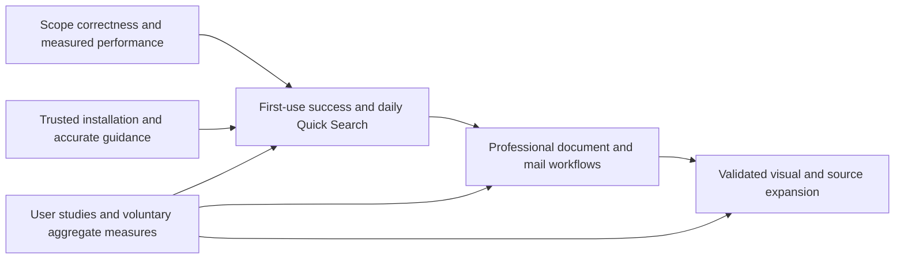

# FileSearch product roadmap

Updated November 6, 2026. Audience: Windows power users and document-heavy professionals.

## Direction

Make FileSearch the tool people use daily to open a file, find a passage, understand a result and complete a reviewed action. Win this audience through reliable scope, fast interaction, useful previews and easy setup.

The [competitive analysis and growth strategy](docs/COMPETITIVE_ANALYSIS_2026-11.md) contains the comparison, source evidence, feature bets and adoption definitions. Repository baseline: `024ac2d7e71104e3358ade0e0b7e3cd585d44c03`, configured version 1.10.0. This is proposed work, not a delivery commitment or a claim of market leadership.

## Already available in source

- Live/indexed content search, Unified/regex/Boolean queries, explicit fuzzy/proximity support, local ranking and optional OCR.
- NTFS whole-drive filename indexing, Quick Search, configurable shortcuts and a separate optional PowerToys companion.
- CSharpDB folder indexing, tray indexing, watching, NTFS USN catch-up, snapshot fallbacks, health diagnostics, resource controls and out-of-process extraction.
- Local ONNX semantic retrieval, desktop model choices, indexed MCP semantic requests and CLI model list/status/install.
- Local MSG/PST/OST search with individual-message results/previews; see [mail coverage](README.Mail.md).
- Facets, sorting/grouping, pins/favorites, saved searches, shared workspace bundles, exports, drag-and-drop and result actions.
- Workflows and reviewed find/replace across supported text/Office content and names, with backups and restart-safe Undo.
- [Benchmark tooling](docs/BENCHMARKS.md), [GUI performance probe](benchmarks/FileSearch.UiPerfProbe/README.md), CI, release packaging and optional signing.
- Default traversal exclusions for `.git`, `.vs`, `node_modules`, `bin` and `obj`.

Improve these foundations instead of duplicating them. Source support is not fresh release verification; packaging configuration is not proof of signed public distribution.

## Milestones and dependencies

P0 denotes a foundation/trust requirement; P1 a near-term audience improvement; P2 an expansion requiring demand or feasibility evidence. Priorities express dependencies and product judgment, not an invented impact score.

Windows below are planning horizons, not capacity estimates. Scope and re-estimate after reproducing correctness risks and collecting the first baseline. Exit gates control dependent work.

| Milestone | Suggested horizon | Outcome | Backlog |
| --- | --- | --- | --- |
| Establish trust and first-use success | First 30 days | Accurate scope, measured performance, understandable setup and verified releases | FS-01–FS-05 |
| Earn daily use | Days 31–90 | Quick Search and project/content search work predictably together | FS-06–FS-09 |
| Complete professional workflows | Months 4–6 | Mail, archives, evidence exports and assistant setup solve real work | FS-10–FS-13 |
| Expand from a proven core | Months 7–12 | Validated visual search and selected source/integration/language extensions | FS-14–FS-17 |

## Milestone 1: establish trust and first-use success

### FS-01 — P0: shared search eligibility and result identity

Apply roots/folders, type, date, size, hidden/excluded-file and visibility restrictions consistently across retrieval providers. Resolve eligibility before semantic file/chunk top-k selection and fallback paths. Reproduce and address any mail identity loss through hybrid fusion/projection while preserving working per-message routes. Keep explicit literal/regex and indexed/live semantics.

**Acceptance:** find qualifying results beyond the initial unrestricted cap; empty eligibility remains empty; nested/removed roots and mail identities behave correctly. Checks exercise observable behavior. Source risks are described in the [analysis](docs/COMPETITIVE_ANALYSIS_2026-11.md#search-restrictions-and-identity-need-consistent-enforcement).

**Dependencies:** none; reuse the shared eligibility design in the [photo plan](docs/PHOTO_CONTENT_SEARCH_PLAN.md).

### FS-02 — P0: performance and relevance qualification

Extend existing standard/full profiles with representative professional documents, scans, archives, Unicode paths and permitted mail fixtures. Record complete-query and first-useful-result latency, cold/warm startup, indexing/catch-up/freshness, memory and disk. Measure metadata-only and model-enabled configurations separately.

Evaluate the hybrid pipeline's collect-before-fusion behavior with slow producers; introduce progressive results only if justified, preserving bounded memory, cancellation and selection. Add held-out human-labeled relevance tasks.

**Acceptance:** reproducible current baseline on named hardware/commit; use [existing internal targets](docs/BENCHMARKS.md); measure quality with timing. Competitor claims require matched corpus, scope, versions and settings. The old smoke result is not release/competitive evidence.

**Dependencies:** baseline work can start immediately; final recall qualification depends on FS-01.

### FS-03 — P0: first-run success and understandable coverage

Observe fresh-profile setup before designing onboarding. Allow useful search during optional indexing, explicit folder choice and optional OCR/model setup. Explain filename versus extracted-content coverage in user terms and give actionable readiness/failure status. Keep normal search useful without an account.

**Acceptance:** a small pilot completes first known-file and document tasks without help; partial/unindexed data is not presented as a definitive no-match. Record completion/time baselines before setting adoption targets.

**Dependencies:** existing health/model services; FS-01/FS-02 for final qualification.

### FS-04 — P0: verified installation and update path

Inspect actual public artifacts/channels. Validate signatures/timestamps/checksums, clean-machine install/upgrade/uninstall and supported-architecture execution. Verify installed executables/sidecars as well as installers. Preserve the separate optional companion.

Choose a user-controlled, recoverable update path for installed and portable distributions. Prepare Store/WinGet channels after identity/signing/update qualification; confirm listings before advertising them.

**Acceptance:** documented clean-machine installation/upgrade and recovery; accurate hardware/channel/signature statements. A workflow condition does not establish public readiness.

**Dependencies:** existing release infrastructure. Public submissions are separate execution actions.

### FS-05 — P0: accurate guidance and an observable pilot

Correct stale Help/docs, including the MCP guide's claim that semantic indexed search is unavailable. Explain current CLI model operations and remaining headless gaps. Keep README, bundled Help, CLI/MCP guides and roadmap aligned.

Recruit a consented pilot. Define productive activity and mature retention cohorts; start with observed tasks or voluntary local aggregate exports.

**Acceptance:** current instructions lead to successful searches; model/index/search readiness is distinguishable; pilot baselines avoid paths, contents and raw queries.

**Dependencies:** FS-03. Telemetry is not authorized; preserve the [privacy policy](PRIVACY.md).

## Milestone 2: earn daily use

### FS-06 — P1: Quick Search ranking and interaction

Evaluate automatic filename abbreviation/typo handling, exact-match protection and optional resettable local usage learning. Reuse scored name/path and recency signals. Keep selection stable during arrivals and make preview, reveal, copy, pin and deep-search handoff fast. Make richer query interpretation intentional; preserve literal/regex behavior.

**Acceptance:** known-file task success/time improves over the current baseline without hurting exact matches, responsiveness, keyboard operation or cancellation.

**Dependencies:** FS-01, FS-02 and FS-03 findings.

### FS-07 — P1: consistent project and all-indexed scope

Extend Quick Search's existing all-indexed capability into the main experience. Reuse scopes, workspaces, saved searches, pins and workflows for project presets. Align restrictions and availability across supported surfaces.

Complete CLI model selection/disable and explicit rebuild control through shared settings. List/status/install already exist. Account for an already-running tray process.

**Acceptance:** the same declared search has consistent eligible results; workspace import/export and restore remain predictable; existing automation/client contracts remain compatible.

**Dependencies:** FS-01 and shared host configuration.

### FS-08 — P1: search diagnosis and precise context

Build “Why wasn't this file found?” from existing coverage, failure, exclusion and provider/model data. Distinguish unavailable, unsupported, stale, partial and no-match states.

Improve context and match navigation, preserving existing PDF page/VS Code line targeting and OCR previews. Extend useful sheet/slide/message/member references where supported. Qualify native-format previews separately.

**Acceptance:** users can resolve representative misses; opening evidence reaches a supported location or explains its fallback; previews remain responsive.

**Dependencies:** FS-01, FS-03 and locator contracts.

### FS-09 — P1: accessibility for core tasks

Verify keyboard focus/order, screen-reader names, high contrast, large text, scaling and relevant input methods in first use, Quick Search, results and previews. Fix blockers while changing those flows. Establish resource-backed strings for changed surfaces.

**Acceptance:** core tasks work with keyboard-only and screen-reader workflows on supported Windows; streaming results/dialogs preserve focus.

**Dependencies:** FS-03, FS-06, FS-08. Known blockers should not wait for a later polish pass.

## Milestone 3: complete professional workflows

### FS-10 — P1: mail fields and attachment content

Add sender/recipient/subject and message-date restrictions. Index supported attachment text with stable identity/locators and bounded extraction. Evaluate incremental updates for changing stores; retain an honest stable-copy path where needed.

**Acceptance:** individual-message identity and restrictions hold; supported attachment content is findable; locked/truncated/unsupported stores have useful status. Store modified dates remain distinct from message dates.

**Dependencies:** FS-01, FS-08 and missing-task evidence. Split fields, attachment support and incremental refresh into separate implementation increments. Remote mailbox sync is a separate connector.

### FS-11 — P1: prioritized archive coverage

Prioritize supported Office/PDF members before broad compression coverage when task evidence supports that order. Evaluate 7z/RAR/TAR and bounded nesting independently. Preserve member/aggregate/depth/execution budgets, locators and partial-coverage warnings.

**Acceptance:** advertised members are retrievable and traceable; encrypted/unsupported/malformed/budget-exceeded entries are explained; extraction and cancellation remain bounded.

**Dependencies:** FS-02, FS-08 and actual missing-source examples.

### FS-12 — P1: evidence exports and workflow templates

Extend existing exports with selected passages, source identity/location and extraction timestamp. Identify changed/missing sources on reopening. Supply a small set of validated professional workspace/workflow examples using existing reviewed actions and Undo.

**Acceptance:** recipients can locate evidence and identify changed sources; exports remain useful offline and disclose partial results. Generated prose is never presented as source text.

**Dependencies:** FS-08; FS-10/FS-11 for richer mail/archive locators.

### FS-13 — P1: guided MCP setup and diagnostics

Improve discovery/setup of the existing read-only server, indexed semantic retrieval and model readiness. Support a small verified client set, preserve settings and provide connection tests. Explain root access and when a chosen AI client may send retrieved text to its provider.

**Acceptance:** supported setup avoids manual JSON editing where clients permit it; upgrades preserve configuration; availability/coverage are accurate; denied roots are not read.

**Dependencies:** FS-01, FS-04, FS-05 and FS-07. Do not rebuild existing semantic MCP routes.

## Milestone 4: expand from a proven core

### FS-14 — P2: qualified photo recognition and similarity

Follow the existing [photo content search plan](docs/PHOTO_CONTENT_SEARCH_PLAN.md): model qualification, durable incremental indexing, filtered retrieval, GUI/Quick Search, CLI/MCP and release gates.

**Acceptance:** real-model held-out relevance/cost qualification, correct scope, cleanup/recovery, thumbnails and host parity. An installed pack or skipped integration test is not qualification.

**Dependencies:** FS-01, FS-02, shared settings and audience value. Phase-0 investigation may happen earlier without committing the whole feature.

### FS-15 — P2: one additional workflow integration

Prototype Open/Save folder navigation or a Flow Launcher provider, selecting from pilot demand. Improve the existing PowerToys companion as needed.

**Acceptance:** repeated tasks improve in target applications; focus, activation, cancellation and optional installation are reliable.

**Dependencies:** FS-06, FS-08 and a scoped compatibility study. Avoid rebuilding a general launcher.

### FS-16 — P2: evidence-led source expansion

Improve synced-folder/network/offline behavior first. If important content is unavailable locally, select at most one initial remote connector. Design credentials, permission changes, deletion, sync and offline semantics before advertising coverage.

**Acceptance:** verified source access/freshness/deletion contract; unavailable sources never appear complete.

**Dependencies:** FS-08, demonstrated source demand and separate integration design.

### FS-17 — P2: language reach and distribution scale

Localize validated core flows and evaluate extraction/OCR/semantic quality by supported language. Expand trusted distribution, examples and community support alongside retained-use evidence. Keep UI language and semantic-model coverage distinct.

**Acceptance:** representative language tasks pass; Help/install/update guidance remains accurate; growth preserves quality and resource behavior.

**Dependencies:** FS-04, FS-05, FS-09 and a stable core.

## Engineering backlog to promote with evidence

- Targeted failed-file retry and remaining CLI maintenance operations; inspect existing per-root commands before adding all-root variants.
- ReFS durable replay using tested 128-bit file identifiers; retain snapshot fallback until qualified.
- Explicit hard-link/path identity policy for delete/rename replay and validation.
- Stable versioned automation DTOs, extractor compatibility, dependency/SBOM reporting and release recovery.
- Index-health history and remediation driven by diagnosis studies.
- Permission-aware filename presentation: the [privacy policy](PRIVACY.md) documents that elevated MFT indexes can contain otherwise unreadable names. Evaluate visibility controls before shared-device/enterprise claims.
- Pre-login Windows Service, team/shared indexes, centralized administration and encryption controls only with proven team requirements.
- More models, GPU/NPU and ANN only when measured retrieval or resource constraints justify them.

Retain CSharpDB and the live correctness fallback for the next phase. This review provides no basis for a store rewrite, cross-platform GUI, general file manager or unrestricted autonomous file actions.

## Measuring progress

Track weekly productive installations, mature week-four retention and observed task success/time. The [analysis defines populations and limitations](docs/COMPETITIVE_ANALYSIS_2026-11.md#define-and-measure-number-one). Establish adoption baselines before numerical targets. Result actions proxy usefulness; downloads/stars indicate reach.

Use [existing performance targets](docs/BENCHMARKS.md), recovery, bounded resources and accessibility as release guardrails. Compare stable and beta products separately. Publish leadership/speed claims only with matching reproducible evidence.

Revise priorities after observing the selected audience's real searches, missing sources and repeat use. Promote features that improve important tasks or remove adoption barriers.

## Working assumptions

- Windows-first GUI; keep Core/CLI cross-platform where practical.
- Local search remains useful without an account; content indexing and model activation remain explicit.
- Remote connectors and telemetry require separate explicit product decisions.
- Per-user tray indexing remains the background baseline.
- Reuse workspaces, scopes, exports, workflows, reviewed replacement and Undo.
- This roadmap does not implement features, install software, publish or submit packages, enable telemetry or create external issues.
