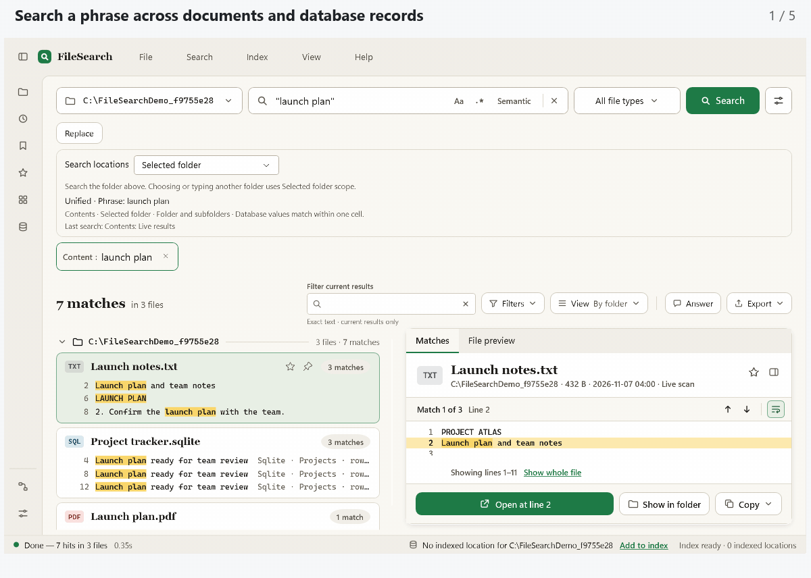

# FileSearch

**Find the file. Find the passage. Keep your place.**

FileSearch is a Windows desktop app for finding files and searching inside documents, email, and local databases. Read the result in context, jump to its page or record, and continue your work.

[**Download for Windows**](https://github.com/MaxAkbar/FileSearch/releases/latest) · [First search](#your-first-search) · [Guides](#go-further) · [Build from source](#build-from-source)



*Real FileSearch windows with sample files. See the [release notes](https://github.com/MaxAkbar/FileSearch/releases/latest) for this version's changes. [View a still image](docs/media/filesearch-overview.png).*

## Get FileSearch

Open the [latest release](https://github.com/MaxAkbar/FileSearch/releases/latest) and choose a Windows download:

| Download | Use it when… |
| --- | --- |
| **MSI installer** | You want FileSearch installed like a regular desktop app. |
| **Portable ZIP** | You want to extract a folder and run `FileSearch.Gui.exe`. Keep the extracted files together. |

The current release provides **Windows x64** downloads. These packages include the .NET runtime; you only need the SDK if you build from source. The separate PowerToys downloads are optional companions, not the main app.

## Your first search

1. **Choose a folder.** Type or browse to the location you want to search.
2. **Choose what to find.** Open **Search options** with the sliders button and select **File names** or **Contents**. Type a word or phrase and select **Search**.
3. **Read the result.** Select a result to see its matches. Switch to **File preview** for the document, page, or record; use **Expand** for more space.

You can start with a live folder search. Add frequently used folders to the index later through **Index → Manage indexed locations**.

While FileSearch is running, press **Win+Shift+F** to open Quick Search. Find a file, open it, or choose **Open full search** to keep investigating. The hotkey is configurable in Settings.

## What can you do with it?

| When you need to… | FileSearch helps you… |
| --- | --- |
| Find a file whose name you partly remember | Search file and folder names, narrow by type, and use Quick Search without opening the full window. |
| Find a passage inside a document | Search PDFs, Word, Excel, PowerPoint, text, and more, then inspect the matching page, sheet, or source text. |
| Investigate a result | Preview it, find and highlight another phrase, move between matches, and expand the same view. |
| Search email or database records | Search local mail messages or read-only SQLite/CSharpDB values while retaining message, table, row, and column locations. |
| Repeat a search across your work | Index selected folders, save searches, pin results, and reopen a workspace. |
| Make a reviewed batch change | Preview find-and-replace changes in supported files or names, choose what to apply, and use Undo. |

### Try a few searches

The matching mode matters. Choose it in **Search options** before using these examples:

| Mode | Search | Meaning |
| --- | --- | --- |
| Plain text | `renewal date` | The exact text, including the space. |
| Unified | `renewal invoice` | Both terms must match. |
| Unified | `renewal OR extension` | Either term can match. |
| Unified | `type:pdf "renewal date"` | Find that phrase in PDF files. |
| Unified | `from:alice subject:invoice` | Match the sender and subject of the same mail message. |
| Regular expression | `TODO|FIXME` | Match either pattern. |

Choose **Contents** and enable **Document & database text** for document and mail examples. Ordinary content terms must match within one extracted line, or one database cell, where applicable. A separate **File pattern**, such as `*.cs;*.txt`, chooses which files to search.

### Three ways to look closer

- **Matches** shows the excerpts returned by your search.
- **File preview** shows the supported document part: a whole PDF page, spreadsheet grid, message, chapter, database page, or loaded text.
- **Find in preview** searches and highlights the loaded text or displayed PDF page. **Find in table** can scan beyond the currently loaded database page. Each view explains its coverage and limits.

**Filter current results** narrows what the search already returned. Run a new search to look beyond those results.

## What can it read?

- **Documents:** PDF, Word, Excel, PowerPoint, OpenDocument, RTF, and EPUB.
- **Text and code:** plain text, Markdown, source files, HTML, and XML.
- **Mail:** EML, MSG, and local PST/OST stores, without requiring Outlook.
- **Archives:** supported ZIP members, including text from PDF and modern Office documents.
- **Databases:** local SQLite and CSharpDB tables, opened through read-only private snapshots.
- **Images and scans:** optional Windows OCR for supported images, scanned PDFs, and supported embedded images.

Images also have built-in previews, including animated GIF, WebP, and multipage TIFF. WebP requires an available Windows decoder; otherwise FileSearch shows file details and keeps Open available. Extra Windows preview handlers can extend the available viewers. Protected, unsupported, or oversized content may be skipped or shown with a limited preview; the [bundled Help](src/FileSearch.Gui/Help/index.html) explains the boundaries.

## Start simple, add what you need

**Indexing** keeps selected folders ready for repeat searches. You can search a folder, selected indexed locations, or all indexed locations. The app explains when it falls back to a live scan or when coverage is incomplete. [Indexing guide](README.Indexing.md)

**OCR** reads text in images and scans. It is a separate opt-in because it adds processing time. [OCR guide](src/FileSearch.Gui/Help/search.html)

**Smart Search** finds related meaning in a local index using a downloaded model. Ordinary filename and text searches work without it. [Smart Search setup](src/FileSearch.Gui/Help/smart-search.html)

**PowerToys Command Palette** can search compatible FileSearch indexes through a separately installed companion. FileSearch works normally without PowerToys. [PowerToys setup](README.PowerToys.md)

Search and indexing run locally. You choose the folders to index and the optional features to enable. See [Privacy](PRIVACY.md) and [Security](SECURITY.md) for storage, resource access, and integration details.

## Go further

| Guide | What you will find |
| --- | --- |
| [In-app Help](src/FileSearch.Gui/Help/index.html) | Search, previews, shortcuts, settings, and troubleshooting. Also available from the app's Help menu. |
| [Database search](README.Databases.md) | SQLite/CSharpDB search, paging, Find, snapshots, and limits. |
| [Mail search](README.Mail.md) | Message fields, dates, stores, previews, and coverage. |
| [Command line](README.Cli.md) | Interactive commands, one-shot searches, exports, and index operations. |
| [Workflows](README.Workflows.md) | Repeatable searches, reviewed replacement, and workspace automation. |
| [AI assistants / MCP](README.Mcp.md) | Connecting an assistant to FileSearch; [integration reference](README.McpIntegration.md) for tool schemas and examples. |
| [Custom themes](README.CustomThemes.md) | Theme files and appearance settings. |
| [Developer guide](README.Development.md) | Project layout, core API, PowerShell examples, tests, and packaging. |
| [Changelog](CHANGELOG.md) | Unreleased changes and release history. |

## Build from source

Use Windows and the **.NET 10 SDK**:

```powershell
git clone https://github.com/MaxAkbar/FileSearch.git
cd FileSearch
dotnet run --project src/FileSearch.Gui
```

For builds, tests, the reusable search engine, or packaging, see the [developer guide](README.Development.md).

## Benchmark results

Local development benchmarks cover searches over generated files, SQLite/CSharpDB previews, and filename ranking. Selected navigation and ranking cases improved, with mixed timing and resource results; broader performance qualification remains open. See the [methodology](docs/BENCHMARKS.md) and [runner guide](benchmarks/FileSearch.Benchmarks/README.md) to reproduce the measurements.

## Contribute

Bug reports, ideas, and pull requests are welcome. Include the matching mode, file type, and steps needed to reproduce a problem. See the [developer guide](README.Development.md) before changing code.

## License

FileSearch is free and open source under the [MIT License](LICENSE). Dependency licenses are listed in [Third-party notices](THIRD-PARTY-NOTICES.md).
